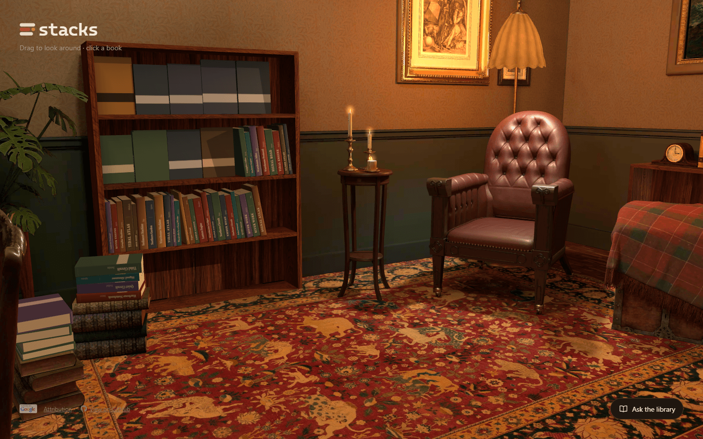

# Stacks

A local-first reading tracker where your Obsidian vault (or any folder of Markdown files) is the database, rendered as a 3D reading room and bookshelf you can publish as a static site.

`stacks add` writes a book note with YAML frontmatter into your vault, fetching metadata and cover art for you. `stacks build` reads your notes back and stages a static site with a 3D bookcase you can browse and share.

There is no account or hosted database. Delete this tool and you still have your Markdown notes.



[See a live library](https://stacks.aymandiab.com)

## What you can do

- Walk up to your bookcase in a 3D reading room. Drag to turn the view, scroll or pinch to move closer, and right-drag, shift-drag, or two-finger drag to pan. Books you are currently reading stand face-out at the front, and abandoned books sit on their own bookcase in the room.
- Click any book to pull it off the shelf. Turn it in your hand by dragging or pressing the arrow keys, then click it or select Open to read its metadata and anything you wrote under `## Thoughts`.
- Add an optional AI Q&A drawer (`packages/ask`, backed by a Cloudflare Worker) so visitors can ask questions about your reading list and jump straight to mentioned books. Plain static builds work without it.
- Edit any book note directly in Obsidian or another text editor. Stacks tolerates extra or reordered frontmatter keys, updates individual lines without reformatting your YAML, and skips malformed notes with a warning so one bad file never breaks a build.

## Quick preview

You need Node 24+ and pnpm. The repository includes a small fixture vault of invented books, so you can try the 3D shelf locally without an Obsidian vault or an API key:

```bash
git clone https://github.com/mephistopheles4/stacks.git
cd stacks
pnpm install
pnpm stacks build --public --vault fixtures/vault
pnpm dev
```

Open `http://localhost:4321` in your browser.

## How book notes work

Every book is a Markdown file with YAML frontmatter. Only `type: book` and `title` are required. `stacks add` creates notes in this format for you, or you can write and edit them by hand:

```markdown
---
type: book
title: "The Tidal Engine"
author: "Maren Lindqvist"
status: read
finished: 2026-08-14
rating: 5
pages: 312
binding: hardback
face_out: true
shelf_order: 10
tags: [fiction, maritime]
---

## Thoughts

A spare, slow-moving story about keeping a lighthouse log through a winter storm.
Plain paragraphs written here appear when a visitor opens the book on the shelf.

## Notes

Private reading notes, quotes, and reminders stay here and never leave your machine.
```

Common frontmatter fields:

| Field | What it controls |
| --- | --- |
| `status` | `reading`, `read`, `abandoned`, or `wishlist` (defaults to `read`) |
| `rating` | Score from `1` to `5` |
| `face_out` | Forces a book cover-forward (`true`) or spine-out (`false`); unset stands `reading` books face-out |
| `shelf_order` | Manual shelf position, lowest first; books without one sort after pinned books by finish date |
| `binding` | `hardback` or `paperback`, affecting cover overhang and book height |
| `private` | Set `private: true` to exclude the book, its cover, and its thoughts from public builds |

A public build publishes only plain prose under `## Thoughts`. Everything else in the note body, including `## Notes` and any other headings, stays on your machine. If `## Thoughts` contains images, embeds, code fences, tables, or comments, the build withholds the whole section and prints a warning.

## Privacy at a glance

| Published | Never published |
| --- | --- |
| Title, author, ISBN, publisher, publication year, subjects | Note bodies outside `## Thoughts` |
| Reading status, start/finish dates, rating, tags, page count | Vault paths and filenames |
| Re-hosted cover images (512px on shelf, up to 1200px when held) | Books marked `private: true` (including wishlist books) |
| Plain text from `## Thoughts`, plus non-private wishlist books | Covers and `## Thoughts` of any `private: true` book |

`private` fails closed: any value other than a clear "no" (including `private: yes`) keeps the book out of public builds. Covers are re-hosted from the provider that supplied them as documented in [ADR-0013](docs/adr/0013-cover-provenance-and-rehosting.md), and takedown requests are honoured.

## Using your own vault

Stacks runs directly from TypeScript source via `tsx`. There is no Obsidian plugin or npm package yet, so using it with your own library means working from a cloned repository.

Copy the example environment file and point `STACKS_VAULT` at your vault folder:

```bash
cp .env.example .env
```

Set `STACKS_VAULT=/path/to/your/vault` in `.env`. A free `GOOGLE_BOOKS_API_KEY` is also worth adding: Open Library is the primary metadata source, and recent books often fall back to Google Books, which shares an exhausted quota without a key and returns `429`. `.env.example` explains how to create a key and lists optional settings such as `STACKS_LANGUAGE`.

Add a book and start the live-reloading shelf:

```bash
pnpm stacks add "the left hand of darkness"
pnpm dev:watch
```

Editing any note in your vault rebuilds and updates the local shelf about a second later.

To build a static site for hosting:

```bash
pnpm stacks build --public --vault /path/to/your/vault
pnpm --filter @stacks/site build
```

This writes the static bundle to `packages/site/dist/`, ready to deploy to Cloudflare Pages, GitHub Pages, Netlify, or any static file server.

### CLI commands

| Command (`pnpm stacks ...`) | What it does |
| --- | --- |
| `add <isbn-or-title>` | Fetch metadata and cover art, then create a new book note |
| `build` | Parse the vault into `library.json` (supports `--public` and `--watch`) |
| `status` | Print vault totals, books finished this year, currently reading, and missing covers |
| `enrich [title]` | Fill missing metadata fields on existing notes without overwriting existing values |
| `order` | Show the current shelf order or write `shelf_order` values (`--renumber`) |
| `covers` | Report cover provenance or backfill `cover_source` from image dimensions (`--backfill`) |
| `import audible <file>` | Import a Libation JSON export into the vault, deduplicating existing books |

## Contributing

Contributions are welcome. [CONTRIBUTING.md](CONTRIBUTING.md) covers local setup, PR rules, and the required checks (`pnpm test && pnpm build && pnpm gate:public`). Project invariants, the full script list, and architecture decisions live in [AGENTS.md](AGENTS.md) and [docs/adr/](docs/adr/).

Report security issues using [SECURITY.md](SECURITY.md) instead of opening a public issue. Participation is covered by the [Code of Conduct](CODE_OF_CONDUCT.md).

## Tested with BrowserStack

This project is tested with [BrowserStack](https://www.browserstack.com/). Each merge to `main` is tested on three real devices, unless a newer merge cancels its run.

## License

[MIT](LICENSE). Downloaded cover images are not covered by this license; they belong to their publishers, and their reuse depends on the provider that supplied them.
